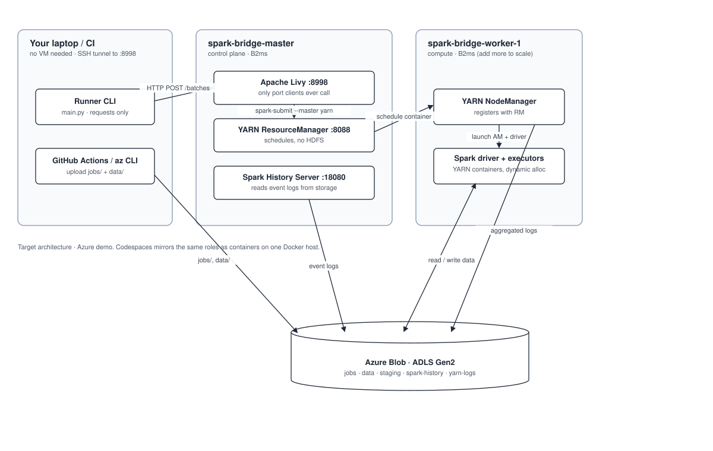

# SparkBridge: Dataproc-lite on YARN, behind a REST API

**"Decoupling Spark Job Submission from Infrastructure Constraints."**

**SparkBridge** turns a few cheap VMs into a small, Dataproc-style Spark cluster. **Apache Livy** is the only entry point (HTTP on port 8998), **YARN** schedules Spark, and **object storage (Azure Blob / ADLS Gen2)** holds the code, data and logs. There is **no HDFS**. Clients such as Airflow, AI agents or plain Python scripts submit and monitor jobs with nothing but the `requests` library: no local Spark, Java or Hadoop.

The same project runs in two environments:

| Environment | Purpose | Where | Storage |
|---|---|---|---|
| **QA: GitHub Codespaces** | "Does it build, launch and run a job?" | 1 host, containers mimic the 2 VMs + your laptop | Shared Docker volume (`file:///data/shared`) |
| **Demo: Azure VMs** | Real job submission against Azure Blob | 2 VMs: master, worker (you run the runner from your laptop) | Azure ADLS Gen2 (`abfss://`) |

---

## Table of Contents

1. [Architecture](#1-architecture)
2. [Tech Stack](#2-tech-stack)
3. [Project Structure](#3-project-structure)
4. [What You Need to Change Before Running](#4-what-you-need-to-change-before-running)
5. [Part A: Run the QA Demo on GitHub Codespaces](#5-part-a-run-the-qa-demo-on-github-codespaces)
6. [Part B: Run the Demo on Azure VMs](#6-part-b-run-the-demo-on-azure-vms)
7. [How a Job Flows](#7-how-a-job-flows)
8. [Configuration Reference](#8-configuration-reference)
9. [Livy REST API Reference](#9-livy-rest-api-reference)
10. [Port Reference](#10-port-reference)
11. [Cost](#11-cost)
12. [Troubleshooting](#12-troubleshooting)
13. [Rollback to the Standalone Version](#13-rollback-to-the-standalone-version)
14. [The Senior Perspective](#14-the-senior-perspective-why-this-matters)

---

## 1. Architecture

### Target architecture (Azure)



The client (your laptop running `src/runner/main.py`, or CI) only ever talks to **port 8998** (Livy) and never needs to know Spark exists.

### Why YARN instead of Spark Standalone

| Problem with Standalone | What YARN gives us |
|---|---|
| PySpark can't run in `cluster` deploy mode, so every driver runs on the master/Livy VM, which becomes the memory bottleneck. | Drivers run in YARN containers on the **worker**. The master only hosts small control-plane daemons. |
| Limited dynamic allocation. | **Dynamic allocation with shuffle tracking**: executors scale 0 → N per job, no extra shuffle daemon. |
| Logs disappear with containers. | **Log aggregation** to object storage, plus the Spark History Server. |
| Config differs from Dataproc. | Same model as Dataproc (`spark.master=yarn`), so jobs and configs are portable. |

### Why no HDFS

Data already lives in object storage. Dropping HDFS removes the NameNode/DataNode daemons, saves RAM and removes a single point of failure. Everything YARN and Spark need to share between nodes goes to storage instead:

```
${STORAGE_ROOT}/                  e.g. abfss://spark@<account>.dfs.core.windows.net/spark-bridge
├── jobs/            PySpark scripts (uploaded by the client / CI)
├── data/            demo data: raw/sales.csv -> curated/sales_by_category/
├── staging/         spark.yarn.stagingDir (small per-job config zip)
├── spark-history/   Spark event logs -> History Server
└── yarn-logs/       YARN aggregated container logs
```

### Dataproc parity

| Dataproc | SparkBridge |
|---|---|
| Master node (YARN RM) | `spark-bridge-master`: RM + Livy + History Server |
| Primary workers (NodeManager) | `spark-bridge-worker` (add more VMs to scale) |
| Jobs API | Livy REST API |
| `gs://` for jobs and data | `abfss://` for jobs, data, staging and logs |
| Component Gateway | SSH tunnel to 8088 / 18080 |
| Autoscaling, init actions | Not in scope (scale manually by adding worker VMs) |

### How Codespaces mimics the Azure VMs

```
GitHub Codespace (one Docker host)
├── "master" network namespace   resourcemanager + history + livy   (= spark-bridge-master)
├── worker                       nodemanager                        (= spark-bridge-worker)
├── client (on demand)           python + requests                  (= your laptop / runner)
└── volume "shared"              mounted at /data/shared            (= Azure Blob)
```

---

## 2. Tech Stack

| Layer | Technology |
|---|---|
| Processing engine | Apache Spark 3.5.1 (`bin-hadoop3`) |
| Resource manager | Apache Hadoop YARN 3.3.6 (RM + NM only, no HDFS). Spark keeps its bundled 3.3.4 client; the two are wire-compatible |
| REST gateway | Apache Livy 0.8.0 (Scala 2.12 / Spark 3 build) |
| Storage connector | `hadoop-azure` (ABFS) on both the Hadoop and Spark classpaths |
| Container base | `eclipse-temurin:11-jre-jammy` (OpenJDK 11 on Ubuntu 22.04) |
| Build sources | Spark and Hadoop copied from the official `apache/spark:3.5.1` / `apache/hadoop:3.3.6` images (Docker Hub CDN), Livy from `dlcdn.apache.org`, Azure jars from Maven Central |
| Runtime | Docker + Docker Compose |
| Client | Python 3 + `requests` |
| Jobs | PySpark |

---

## 3. Project Structure

```
spark-bridge/
├── .github/
│   ├── workflows/deploy-azure.yml        # deploy to the Azure VMs (manual, or called by CI) (B9)
│   ├── workflows/ci.yml                  # tests + Azure image build, then deploy on main
│   └── actions-config.example            # which GitHub secrets/variables to set
├── .devcontainer/devcontainer.json       # Codespaces: 4 cores / 16 GB + Docker-in-Docker
├── tests/                                # pytest: runner + Livy client
├── data/sample/sales.csv                 # demo input data
├── scripts/
│   ├── deploy_jobs_azure.sh              # Azure: upload jobs/data to Blob with az CLI (used by CI/CD)
│   └── archive/                          # Codespaces QA only, not used by CI/CD
│       ├── codespaces_smoke_test.sh      # build, start, wait, submit -> PASS/FAIL
│       └── upload_local_storage.sh       # "upload" jobs/data into the shared volume
├── src/
│   ├── jobs/                             # PySpark scripts -- run ON the cluster
│   │   ├── pi_estimation.py              # compute-only smoke job
│   │   ├── sales_etl.py                  # CSV in storage -> Parquet in storage
│   │   ├── word_count.py
│   │   └── sales_report.py
│   ├── runner/                           # runs on ANY machine (requests only)
│   │   ├── main.py                       # CLI: python main.py <livy_url> <storage> <container/file.py>
│   │   └── livy_client.py                # reusable LivyClient (batches, sessions, logs)
│   └── requirements.txt
└── infrastructure/
    ├── common/                           # shared by both images
    │   ├── entrypoint.sh                 # roles: resourcemanager | nodemanager | history | livy | smoke-storage
    │   └── conf/*.tpl                    # core-site, yarn-site, capacity-scheduler, spark-defaults, livy
    ├── codespaces/                       # QA
    │   ├── Dockerfile                    # no cloud connector, smaller image
    │   └── docker-compose.yml            # all roles on one host + client container
    └── azure/                            # demo
        ├── Dockerfile                    # + Azure ABFS connector
        ├── compose.master.yml            # run on spark-bridge-master
        ├── compose.worker.yml            # run on spark-bridge-worker
        └── .env.example                  # copy to .env and fill in
```

Both images share `infrastructure/common/` (the Docker build context is `infrastructure/`), and every config file is rendered from environment variables at container start. The **only** difference between the two Dockerfiles is the Azure connector block. If you bump a version `ARG`, change it in both files.

---

## 4. What You Need to Change Before Running

| # | What | Where | Codespaces | Azure |
|---|---|---|:-:|:-:|
| 1 | Push this repo (with the new files) to GitHub | `git push` | ✅ | ✅ |
| 2 | Pick a globally unique **storage account name** (3–24 lowercase letters/digits) | `ACCT=` in step B1 | – | ✅ |
| 3 | Fill in `.env` from `.env.example`: `MASTER_HOST`, `AZURE_STORAGE_ACCOUNT`, `STORAGE_ROOT`, `AZURE_STORAGE_KEY` | `infrastructure/azure/.env` | – | ✅ |
| 4 | Match worker sizing to the worker VM: `NM_MEMORY_MB`, `NM_VCORES` | same `.env` | – | ✅ |
| 5 | Your repo URL in `git clone` (private repo: use a GitHub PAT or `gh auth login`); not needed if you deploy with the GitHub Actions workflow (B9) | step B3 / B4 | – | ✅ |
| 6 | Azure region (`LOC=`) and auto-shutdown time | step B1 | – | ✅ |

Nothing else needs editing: no hostnames or keys are hardcoded. `.env` is in `.gitignore`, so **never commit it**.

Commit and push the project first (both demos clone it from GitHub):

```bash
git add .
git commit -m "Add YARN profile for Codespaces QA and Azure demo"
git push origin main
```

---

## 5. Part A: Run the QA Demo on GitHub Codespaces

> **Archived.** CI/CD and the Azure deploy no longer touch Codespaces: CI builds only the Azure image, and the Codespaces scripts live in `scripts/archive/`. This section is kept for trying the stack without Azure. It runs only the pi job (the ETL job's paths point at `abfss://`).

**Goal:** prove the image builds and a job runs end-to-end through Livy → YARN, without any Azure account.

### A1. Create the Codespace

1. On GitHub, open the repo → **Code** → **Codespaces** → **⋯** → **New with options**.
2. Branch `main`, machine type **4-core / 16 GB** (the devcontainer requests it; 2-core / 8 GB also works but is slower).
3. Wait for the container to build. It installs Docker-in-Docker and `pip install -r src/requirements.txt`.

### A2. Run the smoke test

In the Codespace terminal:

```bash
bash scripts/archive/codespaces_smoke_test.sh
```

What it does:

| Step | Action | Time |
|---|---|---|
| 1 | Builds `spark-bridge-yarn:codespaces` (downloads Spark, Hadoop, Livy, ~1.2 GB) | 5–10 min first time |
| 2 | Starts `resourcemanager`, `history`, `livy` (hostname `master`) and `nodemanager` (hostname `worker`) | ~30 s |
| 3 | Waits until YARN is up, the NodeManager is registered, and Livy and History answer | ~30–60 s |
| 4 | Runs the `client` container: copies `src/jobs/*.py` + `data/sample/sales.csv` into the shared volume, then submits **PiEstimation** through Livy | 1–2 min |

### A3. Check the result

Expected end of output:

```
[INFO]  pi_estimation -> state=success  yarnAppId=application_...
```

Open the **Ports** tab in Codespaces and click:

| Port | What to check |
|---|---|
| 8088 (YARN RM UI) | Both applications are `FINISHED / SUCCEEDED`; click an app → **Logs** to see the driver's `print()` / `df.show()` output |
| 18080 (Spark History) | Both apps are listed with their stages |
| 8042 (NodeManager UI) | The worker node and its containers |
| 8998 (Livy) | Batch list with `success` state |

Useful commands:

```bash
COMPOSE="docker compose -f infrastructure/codespaces/docker-compose.yml"
$COMPOSE ps                               # container status
$COMPOSE logs -f livy                     # follow Livy logs
$COMPOSE run --rm client                  # re-run the demo jobs
docker exec sb-resourcemanager yarn application -list -appStates ALL
docker exec sb-resourcemanager ls -R /data/shared/data/curated    # Parquet output
```

You can also submit from the Codespace terminal itself (after the client container has uploaded the files once):

```bash
python src/runner/main.py http://localhost:8998 local jobs/pi_estimation.py
```

#### Calling Livy through the forwarded URL (`https://<codespace>-8998.app.github.dev`)

Codespaces forwarded ports are **private** by default: a request without your GitHub login is redirected to a GitHub sign-in page. The client then fails with `JSONDecodeError: Expecting value`, because it received HTML instead of Livy's JSON.

| Where the client runs | `LIVY_URL` | Extra |
|---|---|---|
| Codespace terminal | `http://localhost:8998` | none (simplest) |
| Your laptop / another machine | `https://<codespace>-8998.app.github.dev` | `LIVY_GITHUB_TOKEN` = the codespace's `$GITHUB_TOKEN`, sent as the `X-Github-Token` header; the port stays private |
| Anyone on the internet | same URL, port set to **Public** | ⚠️ Don't: Livy has no authentication, so a public port lets anyone run code in your codespace |

```bash
# 1) in the codespace terminal: print its token and copy it
echo $GITHUB_TOKEN

# 2) on your laptop
export LIVY_GITHUB_TOKEN=<token from step 1>      # treat it like a password; it expires with the codespace
python src/runner/main.py https://<codespace>-8998.app.github.dev local jobs/pi_estimation.py
```

Set the URL with the environment variable rather than editing the default in code: each codespace gets a different URL, and the code stays the same for Azure.

### Running jobs with the runner

`src/runner/main.py` submits one PySpark file as a Livy batch job, waits, and exits non-zero on failure (so CI can use it).

```
python src/runner/main.py <livy_url> <storage_account> <container/path/to/job.py> [options]
```

| Positional | Meaning |
|---|---|
| `livy_url` | Livy endpoint. From your laptop use the SSH tunnel: `http://localhost:8998` (see B5). Inside the VNet: `http://spark-bridge-master:8998` |
| `storage_account` | ADLS account name (e.g. `dataplatform`), or `local` for the Codespaces shared volume |
| `container/path` | First segment is the container, the rest is the blob path. Becomes `abfss://<container>@<account>.dfs.core.windows.net/<path>` |

| Option | Default | Meaning |
|---|---|---|
| `--name` | file name | Spark app name |
| `--executors N` | cluster default | Number of executors |
| `--cores N` | cluster default | Cores per executor |
| `--executor-memory 2g` | cluster default | Executor heap |
| `--driver-memory 1g` | cluster default | Driver heap |
| `--timeout` | 3600 | Max seconds to wait |

The runner only runs and configures the job. Data paths live inside the job code (e.g. `INPUT_PATH` in `sales_etl.py`), not on the command line.

`LIVY_GITHUB_TOKEN` (env) is only needed for a private Codespaces forwarded URL.

Examples:

```bash
# Compute-only job
python src/runner/main.py http://localhost:8998 dataplatform spark/spark-bridge/jobs/pi_estimation.py

# ETL: CSV -> Parquet (input/output paths are defined inside sales_etl.py), explicit sizing
python src/runner/main.py http://localhost:8998 dataplatform spark/spark-bridge/jobs/sales_etl.py \
  --executors 4 --cores 2 --executor-memory 2g --driver-memory 1g

# Custom app name
python src/runner/main.py http://localhost:8998 dataplatform spark/spark-bridge/jobs/word_count.py --name WordCount

# Codespaces (local shared volume)
python src/runner/main.py http://localhost:8998 local jobs/pi_estimation.py
```

### A4. Clean up

```bash
bash scripts/archive/codespaces_smoke_test.sh down     # stop containers and delete volumes
```

Then **stop the Codespace** (GitHub → Codespaces → ⋯ → Stop). It bills by core-hour while running.

**Done when:** both jobs end in `state=success`, the apps show `SUCCEEDED` in the RM UI, and they're listed in the History Server.

---

## 6. Part B: Run the Demo on Azure VMs

**Goal:** 2 VMs in one VNet (master + worker). Your laptop submits to Livy (from your IP, or over an SSH tunnel), the job reads and writes **real Azure Blob storage**, and drivers and executors run on the worker only.

```
          VNet vnet-eastus-1 · subnet snet-eastus-1 · one NSG per VM
 ┌────────────────┐   :8998 / :8088   ┌────────────────────────────┐   default VNet rule   ┌──────────────────────┐
 │ your laptop    │ ────────────────► │ spark-bridge-master        │ ◄───────────────────► │ spark-bridge-worker  │
 │ runner/main.py │  (your IP only)   │ B2ms · 172.16.0.4          │  YARN / Spark ports   │ B2ms                 │
 │ or GitHub CI   │                   │ RM · Livy · History Server │                       │ YARN NodeManager     │
 └───────┬────────┘                   └─────────────┬──────────────┘                       └──────────┬───────────┘
         │ upload jobs/data (CI)                    │ staging, event logs                             │ read/write data, logs
         └──────────────────────────────► Storage account (ADLS Gen2) · container "spark" ◄───────────┘
```

Prerequisites on your laptop: [Azure CLI](https://learn.microsoft.com/cli/azure/install-azure-cli), `az login`, and an SSH client.

### B1. Provision Azure resources (from your laptop, once)

> Already created the VMs in the Azure Portal? Skip the CLI below and go to **Network rules**, then B2. Every VM name in this README is an example (`spark-bridge-master`, `spark-bridge-worker`): use your own, and set `MASTER_HOST` to the master's name or private IP.

```bash
# ---- change these -------------------------------------------------------------
RG=rg-sparkbridge
LOC=southeastasia
ACCT=sparkbridge$RANDOM                  # storage account: globally unique, lowercase
MY_IP=$(curl -s https://ifconfig.me)     # your public IP
# --------------------------------------------------------------------------------

az group create -n $RG -l $LOC

# Network + one NSG for both VMs (rules: see "Network rules" below)
az network vnet create -g $RG -n vnet-sb --address-prefix 10.10.0.0/16 \
  --subnet-name snet-sb --subnet-prefix 10.10.1.0/24
az network nsg create -g $RG -n nsg-sb

# Storage: ADLS Gen2 (hierarchical namespace ON) -- required for abfss://
az storage account create -g $RG -n $ACCT -l $LOC \
  --sku Standard_LRS --kind StorageV2 --hns true
KEY=$(az storage account keys list -g $RG -n $ACCT --query [0].value -o tsv)
az storage container create --account-name $ACCT --account-key $KEY -n spark
echo "ACCT=$ACCT"; echo "KEY=$KEY"                  # copy both, you need them in B3-B5

# 2 Ubuntu 22.04 VMs. Public IPs are only for SSH + outbound downloads;
# the NSG blocks everything from the internet except what you allow below.
COMMON="-g $RG --image Ubuntu2204 --vnet-name vnet-sb --subnet snet-sb --nsg nsg-sb \
        --admin-username azureuser --generate-ssh-keys"
az vm create $COMMON -n spark-bridge-master   --size Standard_B2ms
az vm create $COMMON -n spark-bridge-worker --size Standard_B2ms

# Cost guard: shut all VMs down every day at 15:00 UTC (22:00 Vietnam time)
for vm in spark-bridge-master spark-bridge-worker; do
  az vm auto-shutdown -g $RG -n $vm --time 1500
done

# Public IPs for SSH
az vm list-ip-addresses -g $RG -o table
```

#### Creating the VMs in the Azure Portal: checklist (do this for BOTH VMs)

The most common failure is a worker that cannot see the master because the portal created it in a **new VNet**. Both VMs then get the same private IP (`172.16.0.4`), YARN shows `activeNodes: 0` and jobs sit in `starting` forever. A VM cannot change VNet afterwards, so get it right at creation:

| Tab | Setting | Value |
|---|---|---|
| Basics | Region | The same region for both VMs and the storage account |
| Basics | Size / image | B2ms (matches `NM_MEMORY_MB=6144`, `NM_VCORES=2`) / Ubuntu 22.04 |
| Basics | SSH key | Create it once on the master; on the worker choose **Use existing key stored in Azure** so one `.pem` and one `VM_SSH_PRIVATE_KEY` secret work for both |
| **Networking** | **Virtual network / Subnet** | **The master's existing VNet and subnet** (e.g. `vnet-eastus-1` / `snet-eastus-1`). Never accept a new VNet for the worker |
| Networking | Public IP / NSG / inbound ports | New public IP, **Basic** NSG, allow **SSH (22)** |

Right after creating the worker, verify before deploying anything:

```bash
hostname -I                          # run on BOTH VMs: the private IPs must DIFFER (e.g. 172.16.0.4 and 172.16.0.5)
getent hosts spark-bridge-master     # on the worker: must print the master's private IP
```

The deploy workflow (B9) also checks this: after both VMs are deployed it fails if no NodeManager has registered with the ResourceManager.

#### Network rules (NSG)

Each VM has its own NSG (Portal -> VM -> Networking -> Network settings). Both VMs must be in the **same VNet** (`vnet-eastus-1`). When you create the second VM in the portal, pick the *existing* VNet and subnet on the Networking tab; the portal's default is a brand-new VNet, which gets the same address range and the same first private IP (e.g. both VMs end up as `172.16.0.4`), so the VMs cannot see each other. Verify with `hostname -I` on both VMs: the IPs must differ. If they are in the same VNet: then Azure's default `AllowVnetInBound` rule (priority 65000) already lets master and worker reach each other on every port (YARN, Livy callback, Spark's random ports), so no custom rule is needed for that. Use your own public IP where `<my-ip>` appears (check it at ifconfig.me).

**Master NSG, inbound**

| Priority | Name | Port | Protocol | Source | Destination | Action | Purpose |
|---|---|---|---|---|---|---|---|
| 300 | `SSH` | 22 | TCP | Any | Any | Allow | SSH, GitHub Actions deploy (B9), tunnels. Key-only login; restrict to `<my-ip>` after the demo if you don't deploy from Actions |
| 310 | `allow-livy-from-me` | 8998 | Any | `<my-ip>` | Any | Allow | Runner reaches Livy directly. Livy has no authentication: one IP only, remove after the demo |
| 320 | `allow-yarn-ui-from-me` | 8088 | TCP | `<my-ip>` | Any | Allow | YARN ResourceManager UI |
| 330 | `allow-history-from-me` | 18080 | TCP | `<my-ip>` | Any | Allow | Spark History Server (job output and logs) |
| 65000 | `AllowVnetInBound` | Any | Any | VirtualNetwork | VirtualNetwork | Allow | Azure default: worker -> master |
| 65500 | `DenyAllInBound` | Any | Any | Any | Any | Deny | Azure default |

**Worker NSG, inbound**

| Priority | Name | Port | Protocol | Source | Destination | Action | Purpose |
|---|---|---|---|---|---|---|---|
| 300 | `SSH` | 22 | TCP | Any | Any | Allow | GitHub Actions deploy (B9) and your SSH |
| 65000 | `AllowVnetInBound` | Any | Any | VirtualNetwork | VirtualNetwork | Allow | Azure default: master -> NodeManager (8041, 8042) |
| 65500 | `DenyAllInBound` | Any | Any | Any | Any | Deny | Azure default |

Don't open 8042 or any other worker port to the internet.

**Outbound (both NSGs):** keep Azure's defaults (`AllowVnetOutBound`, `AllowInternetOutBound`). They cover Azure Storage (443), Docker Hub, Maven Central and the Apache downloads. Only if outbound is restricted, allow: the VNet, port 443 to service tag `Storage`, ports 80/443 to `Internet`, and port 53.

Name resolution (`spark-bridge-master`, `spark-bridge-worker`) is Azure DNS inside the VNet, so no `/etc/hosts` edits are needed. After B4, check: from the worker `getent hosts spark-bridge-master` and `curl -s http://spark-bridge-master:8088/ws/v1/cluster/info`; from the master `curl -s http://spark-bridge-worker:8042/ws/v1/node/info`. If a name doesn't resolve, set `MASTER_HOST` to the master's private IP (`172.16.0.4` here).

> **Security:** never open 8998, 8088 or 18080 to the whole internet; always restrict the source to your own IP. Livy has no authentication, and anyone who can reach it can run code on your cluster. If you don't open the UI ports, use the SSH tunnel in step B6.

### B2. Install Docker on spark-bridge-master and spark-bridge-worker

SSH to **each** of the two VMs (`ssh azureuser@<public-ip>`) and run:

```bash
curl -fsSL https://get.docker.com | sudo sh
sudo usermod -aG docker $USER
exit            # log out and SSH back in so the docker group applies
```

Check after reconnecting: `docker compose version`.

### B3. Start the master (spark-bridge-master)

> Prefer automation? Skip B3 and B4 and use the GitHub Actions deploy in [B9](#b9-optional-deploy-with-github-actions-no-hand-written-env); it does the same thing on both VMs.

```bash
git clone https://github.com/<your-user>/spark-bridge.git
cd spark-bridge/infrastructure/azure
cp .env.example .env
nano .env
```

Fill in `.env`:

```bash
MASTER_HOST=spark-bridge-master                    # VM name; Azure DNS resolves it inside the VNet
STORAGE_BACKEND=azure
AZURE_STORAGE_ACCOUNT=<ACCT from B1>
STORAGE_ROOT=abfss://spark@<ACCT>.dfs.core.windows.net/spark-bridge
AZURE_AUTH_MODE=key
AZURE_STORAGE_KEY=<key from B1>
NM_MEMORY_MB=6144                        # B2ms worker; use 13312 for B4ms
NM_VCORES=2                              # B2ms worker; use 4 for B4ms
```

Build, check storage access, start:

```bash
docker compose -f compose.master.yml build                              # ~5-10 min
docker compose -f compose.master.yml run --rm resourcemanager smoke-storage
docker compose -f compose.master.yml up -d
docker compose -f compose.master.yml ps                                 # 3 services Up / healthy
```

`smoke-storage` must end with `Storage smoke test PASSED`. It writes to `abfss://` with both the Hadoop client (what YARN uses) and the Spark client (what jobs use), so any connector or credential problem shows up here, not in the middle of a demo.

### B4. Start the worker (spark-bridge-worker)

```bash
git clone https://github.com/<your-user>/spark-bridge.git
cd spark-bridge/infrastructure/azure
cp .env.example .env
nano .env               # paste EXACTLY the same values as on spark-bridge-master

docker compose -f compose.worker.yml build
docker compose -f compose.worker.yml run --rm nodemanager smoke-storage
docker compose -f compose.worker.yml up -d
```

Before starting the worker, confirm it is in the master's VNet: `hostname -I` must print a different private IP than on the master, and `getent hosts spark-bridge-master` must resolve (see the VM checklist in B1).

Verify the worker registered with YARN (on either VM):

```bash
curl -s http://spark-bridge-master:8088/ws/v1/cluster/metrics | grep -o '"activeNodes":[0-9]*'
# -> "activeNodes":1
```

The worker keeps shuffle and spill files on the VM's free temporary SSD (`/mnt/yarn`).

### B5. Upload jobs and submit from your laptop

```bash
pip install -r src/requirements.txt          # only "requests" -- no Spark, no Java

# 1) Upload jobs + demo data to Blob (the GitHub Actions workflow in B9 does this too)
export AZURE_STORAGE_ACCOUNT=<ACCT>
export AZURE_STORAGE_KEY=<key>
export AZURE_STORAGE_CONTAINER=spark
export STORAGE_PREFIX=spark-bridge
bash scripts/deploy_jobs_azure.sh            # needs Azure CLI

# 2) Either use http://<master-public-ip>:8998 directly (needs the allow-livy-from-me rule),
#    or open a tunnel and use http://localhost:8998 (keep this terminal open)
ssh -N -L 8998:localhost:8998 azureuser@<spark-bridge-master-public-ip>

# 3) In another terminal: submit
python src/runner/main.py http://localhost:8998 $AZURE_STORAGE_ACCOUNT spark/spark-bridge/jobs/pi_estimation.py
```

See [Running jobs with the runner](#running-jobs-with-the-runner) for all options. Instead of the tunnel you can add the optional `allow-livy-from-me` inbound rule and use `http://<spark-bridge-master-public-ip>:8998` directly.

### B6. Verify and show the demo

Open `http://<master-public-ip>:8088` (YARN) and `:18080` (History) if you added those rules, or use an SSH tunnel to the master:

```bash
ssh -L 8998:localhost:8998 -L 8088:localhost:8088 -L 18080:localhost:18080 azureuser@<spark-bridge-master-public-ip>
```

| Check | Where |
|---|---|
| App `SUCCEEDED` | http://localhost:8088 |
| Driver ran on **spark-bridge-worker**, not the master | RM UI → app → attempt → container host |
| Job stdout (`df.show()` of the sales report) | RM UI → app → **Logs**, or History |
| Event logs / history | http://localhost:18080 |
| Output Parquet in Blob | Azure Portal → storage account → Storage browser → `spark/spark-bridge/data/curated/sales_by_category/` |
| Aggregated logs and event logs in Blob | `spark/spark-bridge/yarn-logs/` and `spark/spark-bridge/spark-history/` |
| Master memory stays flat while jobs run | `docker stats` on spark-bridge-master |

### B7. Stop / clean up

```bash
# Pause (keeps everything, stops compute billing):
az vm deallocate -g $RG -n spark-bridge-worker --no-wait
az vm deallocate -g $RG -n spark-bridge-master   --no-wait
# Resume: az vm start ... then `docker compose ... up -d` starts automatically (restart: unless-stopped)

# Delete everything when the demo is over:
az group delete -n $RG --yes --no-wait
```

> A VM that is only **stopped** (shut down from inside the OS) still bills for compute. Use **deallocate**.

### B8. Optional: use the VMs' managed identity instead of a storage key

```bash
for vm in spark-bridge-master spark-bridge-worker; do
  PID=$(az vm identity assign -g $RG -n $vm --query systemAssignedIdentity -o tsv)
  az role assignment create --assignee $PID --role "Storage Blob Data Contributor" \
    --scope $(az storage account show -g $RG -n $ACCT --query id -o tsv)
done
```

Then in `.env` set `AZURE_AUTH_MODE=msi`, remove `AZURE_STORAGE_KEY`, and restart both stacks. No secret is stored anywhere.

### B9. Optional: deploy with GitHub Actions (no hand-written `.env`)

[.github/workflows/deploy-azure.yml](.github/workflows/deploy-azure.yml) (manual: **Actions -> Deploy to Azure VMs -> Run workflow**) uploads the jobs to ADLS, renders `.env` on the runner, clones/updates the repo on each VM (`git fetch` of the commit being deployed, using the run's temporary token), copies `.env` over SSH and runs `docker compose up -d --build`. In the repo go to **Settings -> Secrets and variables -> Actions**.

**Secrets**

| Name | Value |
|---|---|
| `AZURE_STORAGE_KEY` | Storage account key (also used to upload jobs, even with `AZURE_AUTH_MODE=msi`) |
| `VM_SSH_PRIVATE_KEY` | Private key whose public half is in `~/.ssh/authorized_keys` on both VMs |

**Variables**

| Name | Example |
|---|---|
| `AZURE_STORAGE_ACCOUNT` | `dataplatform` |
| `AZURE_STORAGE_CONTAINER` | `spark` |
| `STORAGE_PREFIX` | `spark-bridge` |
| `MASTER_HOST` | `spark-bridge-master` (private name used inside the VNet) |
| `MASTER_SSH_HOST` / `WORKER_SSH_HOST` | Public IP or DNS the runner can SSH to |
| `VM_USER` | `azureuser` |
| `NM_MEMORY_MB` / `NM_VCORES` | `6144` / `2` (optional) |
| `AZURE_AUTH_MODE` | `key` (default) or `msi` (optional; then also set `AZURE_MSI_CLIENT_ID`, `AZURE_TENANT_ID` if user-assigned) |

**CI then deploy:** [.github/workflows/ci.yml](.github/workflows/ci.yml) runs on every push to `main` and on pull requests: Python compile + `pytest` (`tests/`), shell syntax, compose-file validation, and a build of the Azure Docker image. On a push to `main` the **deploy** job runs only if all of those pass; pull requests never deploy. The deploy installs Docker on a VM if it is missing, so the VMs need nothing but SSH and `sudo`. A final **verify** step fails the run if no NodeManager has registered with the ResourceManager (usually: the worker is in a different VNet). Run the tests locally with `pip install -r requirements-dev.txt && pytest`.

GitHub-hosted runners must reach the VMs on port 22, and the VMs need `docker` and `git` installed. The repo is cloned to `~/spark-bridge` automatically on the first run.

---

## 7. How a Job Flows

1. **Client** → `POST /batches` on Livy with `file=<STORAGE_ROOT>/jobs/sales_etl.py`.
2. **Livy** runs `spark-submit --master yarn --deploy-mode cluster`. Spark's jars are **not** uploaded: they're already in the image on every node (`spark.yarn.jars=local:/opt/spark/jars/*`, PySpark via `PYSPARK_ARCHIVES_PATH=local:...`). Only a small `__spark_conf__.zip` goes to `<STORAGE_ROOT>/staging`.
3. **YARN ResourceManager** starts the ApplicationMaster + **driver** in a container on the **worker**. Executors scale from 0 to `SPARK_MAX_EXECUTORS` with dynamic allocation (shuffle tracking keeps executors that still hold shuffle data).
4. The job reads `data/raw/sales.csv` and writes `data/curated/...` directly in storage.
5. On finish, the event log goes to `<STORAGE_ROOT>/spark-history` (History Server) and container logs go to `<STORAGE_ROOT>/yarn-logs`. Livy reports `success`, and the runner exits 0.

---

## 8. Configuration Reference

All settings are environment variables (`infrastructure/azure/.env` on Azure, the `environment:` block in `infrastructure/codespaces/docker-compose.yml` for Codespaces). `common/entrypoint.sh` renders them into the Hadoop, Spark and Livy configs at container start.

| Variable | Codespaces | Azure example | Meaning |
|---|---|---|---|
| `MASTER_HOST` | `master` | `spark-bridge-master` | Host of the RM / Livy / History Server |
| `STORAGE_BACKEND` | `local` | `azure` | Which storage credentials to configure |
| `STORAGE_ROOT` | `file:///data/shared` | `abfss://spark@<acct>.dfs.core.windows.net/spark-bridge` | Root for jobs, data, staging, logs |
| `AZURE_STORAGE_ACCOUNT` | – | `<acct>` | Storage account name |
| `AZURE_AUTH_MODE` | – | `key` / `msi` | Account key or VM managed identity |
| `AZURE_STORAGE_KEY` | – | `<key>` | Only for `key` mode |
| `NM_MEMORY_MB` / `NM_VCORES` | `4096` / `4` | `6144` / `2` | Resources the worker offers to YARN |
| `YARN_AM_RESOURCE_PERCENT` | `0.8` | `0.5` | Share of cluster memory for job ApplicationMasters (Hadoop's default 0.1 leaves small clusters stuck in `ACCEPTED`) |
| `SPARK_DRIVER_MEMORY` / `SPARK_EXECUTOR_MEMORY` | `512m` | `1g` | Defaults, overridable per Livy request |
| `SPARK_MAX_EXECUTORS` | `2` | `4` | Dynamic allocation upper bound |
| `YARN_LOCAL_DIR_HOST` | – | `/mnt/yarn` | Worker shuffle/spill dir (Azure temp SSD) |
| `LIVY_LOCAL_DIR_WHITELIST` | `/data/shared/` | – | Lets Livy accept `file://` job paths (Codespaces only) |

YARN queues (`common/conf/capacity-scheduler.xml.tpl`): a single `default` queue with 100% of the cluster.

---

## 9. Livy REST API Reference

Inside the VNet (or through the SSH tunnel, replacing `spark-bridge-master` with `localhost`):

### Submit a batch job (code in Blob)

```bash
ROOT=abfss://spark@<acct>.dfs.core.windows.net/spark-bridge
curl -X POST http://spark-bridge-master:8998/batches -H "Content-Type: application/json" -d '{
  "file":  "'$ROOT'/jobs/sales_etl.py",
  "args":  ["'$ROOT'/data/raw/sales.csv", "'$ROOT'/data/curated/sales_by_category"],
  "name":  "SalesETL",
  "driverMemory":   "1g",
  "executorMemory": "1g"
}'
```

### Poll job state / read logs

```bash
curl http://spark-bridge-master:8998/batches/<batch_id>          # state, appId, YARN UI link
curl http://spark-bridge-master:8998/batches/<batch_id>/log      # spark-submit / YARN client log
```

### Interactive session

```bash
curl -X POST http://spark-bridge-master:8998/sessions -H "Content-Type: application/json" \
  -d '{"kind": "pyspark"}'
curl -X POST http://spark-bridge-master:8998/sessions/<session_id>/statements -H "Content-Type: application/json" \
  -d '{"code": "spark.version"}'
```

### From Python (`requests` only)

```python
from livy_client import LivyClient

client = LivyClient("http://spark-bridge-master:8998")
job = client.submit_batch(
    file=f"{ROOT}/jobs/pi_estimation.py",
    args=["1000000"],
)
print(job.wait())            # 'success'
print(job.get_info()["appId"])
```

---

## 10. Port Reference

| Port | Service | VM | Who accesses it |
|---|---|---|---|
| 8998 | Livy REST API | master | Clients (**the only port clients need**): your IP only (rule `allow-livy-from-me`), or via SSH tunnel |
| 8088 | YARN ResourceManager UI | master | You, from your IP (rule `allow-yarn-ui-from-me`) or via SSH tunnel |
| 8030–8033 | YARN RM RPC | master | NodeManagers, Livy (internal) |
| 18080 | Spark History Server | master | You, from your IP (rule `allow-history-from-me`) or via SSH tunnel |
| 10000–10010 | Livy RSC callback | master | Interactive-session drivers on workers (internal) |
| 8041 / 8042 | NodeManager RPC / UI | worker | RM (internal) / operators |
| dynamic | Spark driver / executors | worker | Each other, Livy (internal) |
| 22 | SSH | all | Any (key-only login, needed by GitHub Actions); restrict to your IP otherwise |

---

## 11. Cost

Pay-as-you-go ballpark (check the [Azure pricing calculator](https://azure.microsoft.com/pricing/calculator/) for your region):

| Resource | Size | ≈ USD / hour |
|---|---|---|
| spark-bridge-master | B2ms (2 vCPU / 8 GB) | ~0.08 |
| spark-bridge-worker | B2ms (2 vCPU / 8 GB) | ~0.08 |
| 2 public IPs | Standard | ~0.01 total |
| Storage | a few MB | ~0 |

A 3-hour demo costs well under **1 USD** in compute. Keep it cheap:

- **Deallocate** VMs when idle and keep the daily auto-shutdown.
- Put the storage account in the **same region** as the VMs (no egress charges).
- For bigger runs, make workers **Spot VMs** (`--priority Spot --eviction-policy Deallocate`); YARN retries lost containers.
- `az group delete -n rg-sparkbridge` when finished.
- On Codespaces, **stop** the Codespace after the test.

---

## 12. Troubleshooting

| Symptom | Likely cause / fix |
|---|---|
| App stuck in `ACCEPTED` | Not enough memory for the ApplicationMaster. Check `activeNodes` ≥ 1, then raise `NM_MEMORY_MB` / `YARN_AM_RESOURCE_PERCENT` or lower `SPARK_DRIVER_MEMORY`. |
| App stuck in `ACCEPTED` / runner prints `Batch 0 state: starting` forever, `activeNodes: 0`, worker log shows `UnknownHostException: spark-bridge-master` | The worker is in a different VNet from the master (both show private IP `172.16.0.4`). Recreate the worker VM on the master's VNet and subnet (Networking tab: choose the existing VNet). A VM cannot change VNet, all NICs of one VM must be in the same VNet, and peering cannot fix it because the address ranges overlap. |
| `activeNodes: 0` | NodeManager can't reach `MASTER_HOST:8031`. Check `docker logs sb-nodemanager`, the `.env` values, that both VMs are in the same VNet, and that the default `AllowVnetInBound` rule hasn't been removed from either NSG. |
| Runner: `Cannot reach Livy` | Tunnel not open (`ssh -N -L 8998:localhost:8998 azureuser@<master-ip>`), or your IP changed and `allow-livy-from-me` is stale: update its source IP (or use the SSH tunnel). |
| GitHub Actions deploy: SSH timeout | The NSG blocks GitHub's runners. Port 22 must allow Any on both VMs' NSGs (the `SSH` rule); check the worker too. |
| NodeManager `UNHEALTHY` | Local disk almost full: `docker system prune`. The threshold is already 99%. |
| `ClassNotFoundException ... azurebfs` | You built with the Codespaces Dockerfile. Use `azure/Dockerfile` (the compose files already do). |
| `403` / `AuthorizationPermissionMismatch` on `abfss://` | Wrong key, or the managed identity lacks *Storage Blob Data Contributor* (role assignments take ~5 min). |
| `UnknownHostException: spark-bridge-worker` | Hostnames not resolvable. All VMs must be in the same VNet (Azure DNS), and `MASTER_HOST` must be correct. |
| Livy: `Local path ... cannot be added to user sessions` | Codespaces only: the `file://` path must be under `/data/shared/`. |
| Interactive session hangs in `starting` | The driver on the worker can't reach Livy on `MASTER_HOST:10000-10010`. |
| Build fails while downloading | The image pulls Spark and Hadoop from the official `apache/spark` / `apache/hadoop` Docker Hub images, Livy from `dlcdn.apache.org` and jars from Maven Central (no `archive.apache.org`). Re-run the build: finished layers are cached. Docker Hub rate limit (`toomanyrequests`): run `docker login`. |
| Where is my `print()` output? | In the driver container log: RM UI → app → **Logs**, or `docker exec sb-resourcemanager yarn logs -applicationId <id>`. |

---

## 13. Rollback to the Standalone Version

The original Spark Standalone stack (Livy 0.7.1, drivers on the master) was removed from `main` to keep one code path. It's preserved under the git tag **`v1-standalone`**:

```bash
git checkout v1-standalone          # browse or run the old stack
cd infrastructure && docker compose up --build
git checkout main                   # back to the YARN version
```

---

## 14. The Senior Perspective: Why This Matters

In modern data platform engineering, **operational simplicity** is as important as raw performance.

Maintaining a consistent Spark environment across multiple developer machines and orchestration servers is a logistical nightmare. **SparkBridge** turns Spark into a **shared service**, and the YARN profile turns a handful of cheap VMs into a "Dataproc-lite":

1. **Strict security:** clients need one private HTTP port. Nothing is exposed to the internet.
2. **Universal compatibility:** any language that can make an HTTP request (Python, Go, Node.js) can trigger heavy data processing.
3. **Stateless compute:** with no HDFS, all state lives in object storage, so VMs can be deallocated, resized or replaced without data loss.
4. **Cheaper by design:** small control plane, drivers on workers, dynamic allocation, Spot-friendly workers, pay only while running.
5. **Cleaner CI/CD:** deploying a job is an upload to Blob plus an API call. No shell access to the cluster.
6. **Portable:** the same `spark.master=yarn` model as Dataproc/EMR/HDInsight, so jobs move between platforms unchanged.

---

## Contact & Contributing

Feel free to reach out for architectural discussions or contribute to the repo.

## Project Demo

You can watch the full demo of this Spark Bridge on YouTube: [Watch here](https://youtu.be/MxiVsNYgirs)
