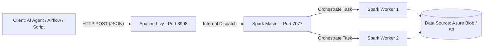

# SparkBridge: Standalone API Gateway

**"Decoupling Spark Job Submission from Infrastructure Constraints."**

**SparkBridge** is a high-performance architectural solution designed to break the traditional dependency on local Spark environments. By leveraging **Apache Livy** as a RESTful gateway for **Spark Standalone**, this project enables remote clients -- such as AI Agents, Airflow Workers, or lightweight local scripts -- to dispatch and monitor large-scale data processing jobs without requiring local Spark binaries or Java installations.

---

## Architecture: The "Stateless" Approach

Unlike the traditional `spark-submit` method which requires a thick client, **SparkBridge** follows a decoupled, API-driven pattern. This separates the **Control Plane** (where the logic lives) from the **Data Plane** (where the processing happens).



The client only ever speaks to **port 8998** (Livy).  It never needs to know that Spark exists.

---

## Key Value Propositions

* **Zero-Client Footprint:** Execute Spark jobs from any environment (Docker, Cloud Functions, CI runners) using only the `requests` library or `curl`.
* **Infrastructure Decoupling:** Eliminate the need to maintain Spark/Hadoop binaries on orchestration nodes (e.g., Airflow workers), reducing maintenance overhead.
* **Centralized Job Management:** Leverage Livy to manage sessions, track job states, and retrieve logs via standard HTTP endpoints.
* **Production-Grade Scalability:** Easily scale the Spark Standalone cluster by adding workers without touching a single line of client-side code.

---

## Tech Stack

| Layer | Technology |
|---|---|
| Processing Engine | Apache Spark 3.5.1 (Standalone Mode) |
| REST Gateway | Apache Livy 0.7.1 |
| Container Base | eclipse-temurin:11-jre-jammy (OpenJDK 11 on Ubuntu 22.04) |
| Container Runtime | Docker + Docker Compose |
| Client Language | Python 3 (`requests` only) |
| Job Language | PySpark |

---

## Project Structure

```
spark-bridge/
├── src/
│   ├── jobs/                          # PySpark scripts -- run ON the cluster
│   │   ├── pi_estimation.py           # Monte Carlo Pi estimation
│   │   ├── word_count.py              # Word frequency analysis
│   │   └── sales_report.py            # Sales aggregation report
│   ├── client/                        # Client code -- runs on ANY machine
│   │   ├── livy_client.py             # Reusable LivyClient class
│   │   ├── example_batch_submit.py    # Submit .py scripts via Livy batch API
│   │   └── example_interactive_session.py  # Send code snippets via Livy sessions
│   └── requirements.txt               # Client deps: requests only
└── infrastructure/
    ├── docker/
    │   ├── Dockerfile                 # Builds the single spark-bridge image
    │   └── livy.conf                  # Livy server configuration
    └── docker-compose.yml             # Full cluster definition (4 services)
```

### Docker service topology

All four services use the **same `spark-bridge` image** (built once from `infrastructure/docker/Dockerfile`).  Each service is given an explicit role via its `command` in docker-compose, making the topology immediately readable.

```
docker-compose up
      |
      +-- spark-master    command: spark-class ...Master
      |       port 8080 (Spark Web UI)
      |       port 7077 (Spark RPC)
      |
      +-- livy            command: livy-server
      |       port 8998 (REST API)  <-- ONLY port clients ever talk to
      |       port 4040 (App Web UI)
      |
      +-- spark-worker-1  command: spark-class ...Worker spark://spark-master:7077
      +-- spark-worker-2  command: spark-class ...Worker spark://spark-master:7077
```

### Key separation of concerns

| Directory | Runs on | Spark/Java needed? |
|---|---|---|
| `src/jobs/` | Spark cluster (inside container) | Yes (provided by image) |
| `src/client/` | Any client machine | No -- `pip install requests` is enough |

---

## Quick Start

### 1. Prerequisites

* Docker Desktop (or Docker Engine + Compose plugin)
* Python 3.8+ on your client machine
* No Spark, no Java required on the client

### 2. Build and start the cluster

```bash
cd infrastructure
docker compose up --build
```

This builds the `spark-bridge` image once and starts four services:

| Service | Role |
|---|---|
| `spark-master` | Spark Master daemon |
| `livy` | Apache Livy REST server -- the client entry point |
| `spark-worker-1` | Spark Worker (2 cores, 2 GB RAM) |
| `spark-worker-2` | Spark Worker (2 cores, 2 GB RAM) |

Wait until you see `INFO LivyServer - Starting server` in the `livy` container logs (around 20--25 seconds).

### 3. Verify the cluster is up

```bash
# Livy health check
curl http://40.139.179.159:8998/sessions

# Spark Master Web UI
open http://40.139.179.159:8080
```

### 4. Install client dependencies (client machine only)

```bash
cd src
pip install -r requirements.txt
```

### 5. Submit a batch job

```bash
cd src/client
python example_batch_submit.py
```

The script submits three batch jobs (Pi Estimation, Word Count, Sales Report) and polls Livy for completion.  No local Spark installation is used.

### 6. Run an interactive session

```bash
cd src/client
python example_interactive_session.py
```

This sends PySpark code snippets as plain strings over HTTP and retrieves the output.  Ideal for notebooks, REPL-style workflows, or dynamic job generation.

---

## Livy REST API Reference

The two most important endpoints for clients:

### Submit a batch job

```bash
curl -X POST http://40.139.179.159:8998/batches \
  -H "Content-Type: application/json" \
  -d '{
    "file":            "local:///opt/spark-jobs/pi_estimation.py",
    "args":            ["1000000"],
    "name":            "PiEstimation",
    "executorMemory":  "512m",
    "driverMemory":    "512m"
  }'
```

### Poll job state

```bash
curl http://40.139.179.159:8998/batches/<batch_id>
```

### Create an interactive session

```bash
curl -X POST http://40.139.179.159:8998/sessions \
  -H "Content-Type: application/json" \
  -d '{"kind": "pyspark"}'
```

### Execute code in a session

```bash
curl -X POST http://40.139.179.159:8998/sessions/<session_id>/statements \
  -H "Content-Type: application/json" \
  -d '{"code": "spark.version"}'
```

---

## Port Reference

| Port | Service | Who accesses it |
|---|---|---|
| 8998 | Livy REST API | Clients (the only port clients need) |
| 8080 | Spark Master Web UI | Operators (monitoring) |
| 7077 | Spark Master RPC | Workers (internal only) |
| 4040 | Spark App Web UI | Operators (active job debugging) |

---

## The Senior Perspective: Why This Matters

In modern data platform engineering, **operational simplicity** is as important as raw performance.

Maintaining a consistent Spark environment across multiple developer machines and orchestration servers is a logistical nightmare. **SparkBridge** transforms Spark into a **Shared Service**. By abstracting the submission process behind a REST API, we enable:

1. **Strict Security:** Firewall rules only need to allow HTTP traffic to the Livy gateway.
2. **Universal Compatibility:** Any language that can make an HTTP request (Python, Go, Node.js, PHP) can trigger heavy-duty data processing.
3. **Cleaner CI/CD:** Deploying new Spark jobs becomes a simple API call rather than a complex shell-script execution.
4. **Reduced Toil:** Spark upgrades, tuning, and scaling are cluster concerns only -- no client changes needed.

---

## Contact & Contributing

Feel free to reach out for architectural discussions or contribute to the repo.